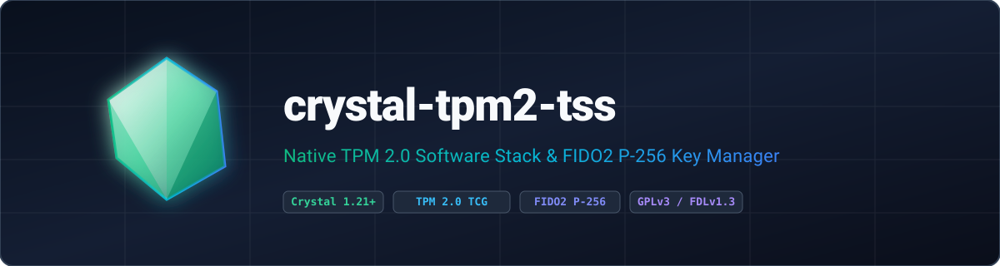

<p align="center">
  
</p>

<p align="center">
  <strong>Native TPM 2.0 Software Stack for Crystal featuring NV key persistence, OpenSSL 3.5 NIST P-256 FIDO2 credentials, KDFa parameter encryption, and O(1) nonce-reuse detection.</strong>
</p>

<p align="center">
  <a href="https://gitlab.com/renich/crystal-tpm2-tss/-/releases"></a>
  <a href="https://crystal-lang.org/">= 1.21.0" /></a>
  <a href="https://gitlab.com/renich/crystal-tpm2-tss/-/pipelines"></a>
  <a href="https://gitlab.com/renich/crystal-tpm2-tss"></a>
  <a href="https://github.com/crystal-ameba/ameba"></a>
  <a href="https://github.com/kdairatchi/flaw"></a>
</p>

<p align="center">
  <a href="https://renich.gitlab.io/crystal-tpm2-tss/"></a>
  <a href="https://renich.gitlab.io/crystal-tpm2-tss/technical/api/"></a>
  <a href="LICENSE"></a>
  <a href="https://liberapay.com/Renich/donate"></a>
</p>

> **GitLab Project Metadata**:
> - **Description**: Native TPM 2.0 Software Stack for Crystal featuring NV key persistence, OpenSSL 3.5 NIST P-256 FIDO2 credentials, KDFa parameter encryption, and O(1) nonce-reuse detection.
> - **Topics and Tags**: `crystal`, `crystal-lang`, `tpm2`, `tss`, `fido2`, `webauthn`, `ecdsa`, `p256`, `hardware-security`, `gplv3`

---

## Overview

**crystal-tpm2-tss** is a native, memory-safe Crystal TPM 2.0 Software Stack implementation providing hardware-backed Key Derivation Function persistence, TCG TPM 2.0 Part 2 binary structure marshaling (`Tpm2bCodec`), salted/bound HMAC and `PolicyPCR` session authorization with `cpHash`/`rpHash` digests, KDFa `XOR` and `AES-128-CFB` parameter encryption, and FIDO2/CTAP2 credential management backed by OpenSSL 3.5 NIST P-256 ECDSA key generation and verification.

### Key Highlights

1. **Hardware-Bound KDF & Disjoint NV Persistence**: Provisions root derivation keys at NV index `0x01C00000` and allocates FIDO2 credential metadata across `0x01800000..0x01BFFFFF` with bounded 16-slot linear collision probing.
2. **Real OpenSSL 3.5 NIST P-256 Verification**: Generates prime256v1 keypairs via `EVP_PKEY`, extracts public `(x, y)` coordinates via `TPM2_ReadPublic`, and cryptographically verifies `ECDSASignature` values.
3. **TCG Part 2 Binary Marshaling (`Tpm2bCodec`)**: Encodes and decodes `TPMS_AUTH_COMMAND`, `TPMS_AUTH_RESPONSE`, `TPM2B_SENSITIVE_CREATE`, `TPM2B_PUBLIC` (`TPMS_ECC_PARMS`), and `TPMT_SIGNATURE` with strict overflow-safe big-endian length validation.
4. **Salted/Bound HMAC, PolicyPCR & Parameter Encryption**: Establishes hardware/simulated sessions via `Session.start_auth_session`, extends `PolicyPCR` digests, verifies response HMACs in constant time, and encrypts command parameters using Section 11.4.9.2 KDFa `XOR` and `AES-128-CFB`.
5. **Atomic O(1) Nonce-Reuse Detection**: Thread-safe `SignatureRTracker` combining `Set(String)` and `Deque(String)` under `Sync::Mutex` to detect duplicate ECDSA `r` components immediately.
6. **Fail-Closed Hardware & Stateful Virtual Transport**: Communicates over `/dev/tpmrm0` using stack-allocated buffers or executes deterministically against an in-memory OpenSSL 3.5 NIST P-256 virtual simulator.

---

## Installation

Add `crystal-tpm2-tss` to your application's `shard.yml`:

```yaml
dependencies:
  crystal-tpm2-tss:
    gitlab: renich/crystal-tpm2-tss
    version: ~> 0.4.1
```

Then install the shard:

```bash
shards install
```

---

## Usage

```crystal
require "crystal-tpm2-tss"

# Initialize TPM device interface (virtual simulator by default, or pass "/dev/tpmrm0")
tpm = TPMDevice.new

# Derive hardware-bound auth key via KDF manager
platform_secret = Random::Secure.random_bytes(32)
kdf_manager = KDFKeyManager.new(tpm, platform_secret)
root_key = kdf_manager.kdf_key
puts "Root KDF Key: [REDACTED #{root_key.size}-byte key]"

# Create FIDO2 credential manager with nonce-reuse protection and P-256 verification
credential_manager = FIDO2CredentialManager.new(tpm, platform_secret)
credential = credential_manager.get_or_create_credential("user-credential-1234")
digest = Random::Secure.random_bytes(32)
signature = credential.sign(digest)
puts "ECDSA Signature valid? #{credential.verify(digest, signature)}"

# Establish a bound session, extend a PolicyPCR digest, and flush context
session = Session.start_auth_session(tpm, auth_value: root_key)
policy_digest = session.policy_pcr(tpm, 7_u32, digest)
puts "PolicyPCR Digest: #{policy_digest.hexstring}"
session.flush(tpm)
```

---

## Build System Targets

The repository includes a standard `GNUmakefile`:

| Target | Description |
| :--- | :--- |
| `make all` | Runs `lint`, `doc-check`, and `test` |
| `make test` | Executes the spec test suite (`crystal spec`) |
| `make lint` | Runs `crystal tool format --check`, Ameba `--all`, and Flaw SAST scanner |
| `make doc-check` | Lints all reStructuredText files using `crstlint` and `rstcheck` |
| `make check` | Aggregates `lint`, `doc-check`, and `test` |
| `make docs` | Generates Crystal API docs and Sphinx `dirhtml` documentation portal |
| `make deps` | Installs Shards dependencies and builds `bin/ameba` and `bin/flaw` |
| `make format` | Formats Crystal source and spec files |
| `make install` | Installs generated documentation to `DESTDIR/DOCDIR` |
| `make clean` | Removes build artifacts, linter binaries, and generated documentation |

---

## Documentation

Full architectural blueprints, functional specifications, D2 diagrams, and operational playbooks are maintained under [`docs/`](docs/index.rst):

| Guide | Scope & Highlights | Entry Point |
| :--- | :--- | :--- |
| **Business Context & Strategy** | Ecosystem problem statement, security ROI goals, and personas. | [Business Specs](docs/business/spec.rst) |
| **Functional Specifications** | Requirements `[FUNC-001]`–`[FUNC-007]` and behavioral contracts. | [Functional Specs](docs/functional/spec.rst) |
| **Technical Architecture** | Specifications `[TECH-001]`–`[TECH-007]`, D2 topology, and threat model. | [Technical Specs](docs/technical/spec.rst) |
| **Release Playbook** | SemVer, Keep a Changelog, and GPG-signed GitLab release steps. | [Release Procedure](docs/technical/specs/release-procedure.rst) |
| **Architecture Decisions (ADRs)** | Immutable logs of architectural decisions and trade-offs. | [ADR Index](docs/adrs/index.rst) |
| **Project Roadmap** | Phased milestone tracking, D2 dependency graphs, and audit logs. | [Project Roadmap](docs/project/roadmap.rst) |
| **User Guides** | Installation, virtual simulator, and hardware TPM usage tutorials. | [User Manual](docs/user/index.rst) |
| **Crystal API Reference** | Complete interactive type hierarchy and method signatures. | [API Reference](https://renich.gitlab.io/crystal-tpm2-tss/technical/api/) |

---

## Contributing & Code of Honor

All contributions must adhere to the [Universal Code of Honor](CODE_OF_HONOR.rst) and [Contributing Guidelines](CONTRIBUTING.rst).

---

## License

- **Software**: GNU General Public License v3.0 or later ([LICENSE](LICENSE)).
- **Documentation**: GNU Free Documentation License v1.3 or later ([LICENSE-DOCS](LICENSE-DOCS)).

Copyleft &copy; 2026 Rénich Bon Ćirić &lt;renich@evalinux.com&gt;.

---

## Support & Donations

If you find this shard useful and wish to support its ongoing development, please consider donating:

<p align="center">
  <a href="https://liberapay.com/Renich/donate">
    
  </a>
</p>
