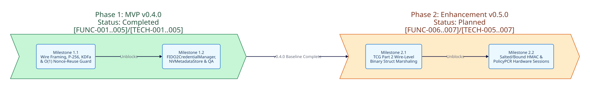

===============
Project Roadmap
===============

Overview
--------

This document tracks the phased implementation milestones, atomic delivery tasks, dependency graphs, and 1:1 bidirectional requirement traceability for ``crystal-tpm2-tss``.

Macro Timeline Diagram
----------------------

Phase Summary
-------------

.. list-table::
   :widths: 20 15 30 35
   :header-rows: 1

   * - Phase
     - Status
     - Requirement Coverage
     - Primary Deliverables
   * - :doc:`roadmaps/phase-1-mvp`
     - Completed ``v0.4.0``
     - ``[FUNC-001]``..``[FUNC-005]``, ``[TECH-001]``..``[TECH-005]``
     - Wire framing, OpenSSL 3.5 NIST P-256 verification, FIDO2 NV persistence, KDFa ``XOR``/``AES-128-CFB`` encryption, and ``O(1)`` ECDSA nonce-reuse tracking.
   * - :doc:`roadmaps/phase-2-enhancement`
     - Planned ``v0.5.0``
     - ``[FUNC-006]``..``[FUNC-007]``, ``[TECH-005]``..``[TECH-007]``
     - ``Tpm2bCodec`` TCG Part 2 binary struct marshaling and hardware salted/bound HMAC and ``PolicyPCR`` session lifecycles.

.. toctree::
   :maxdepth: 1
   :caption: Roadmap Phases

   roadmaps/phase-1-mvp
   roadmaps/phase-2-enhancement
   audits/index
