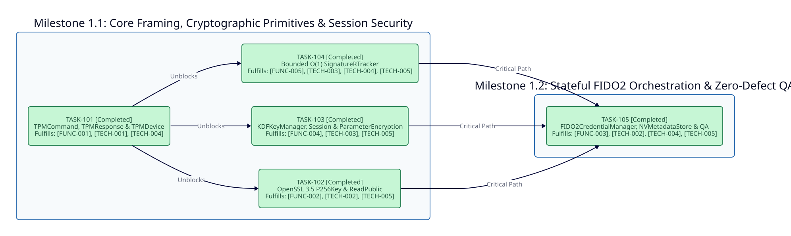

============
Phase 1: MVP
============

Timeline and Objectives
-----------------------

Deliver the production-complete ``v0.4.0`` native TPM 2.0 Software Stack in Crystal, supporting big-endian wire framing, OpenSSL 3.5 NIST P-256 key generation and verification, ``cpHash``/``rpHash`` session authorization, KDFa ``XOR`` and ``AES-128-CFB`` parameter encryption, ``O(1)`` ECDSA nonce-reuse detection, and persistent FIDO2 NV credential management.

Dependency Graph
----------------

Milestone 1.1: Core TPM 2.0 Framing, Cryptographic Primitives, and Session Security
-----------------------------------------------------------------------------------

* **TASK-101: TPMCommand, TPMResponse, and TPMDevice Transport**:

  * **Status**: Completed
  * **Fulfills**: ``[FUNC-001]``, ``[TECH-001]``, ``[TECH-004]``
  * **Blocked By**: None
  * **Unblocks**: ``TASK-102``, ``TASK-103``, ``TASK-104``
  * **Deliverable**: Implement ``TPMCommand`` serialization, ``UInt64`` overflow-safe ``TPMResponse.parse`` session slicing, and ``TPMDevice`` fail-closed ``/dev/tpmrm0`` stack-buffered I/O with virtual simulation fallback.

* **TASK-102: OpenSSL 3.5 NIST P-256 P256Key and TPM2_ReadPublic**:

  * **Status**: Completed
  * **Fulfills**: ``[FUNC-002]``, ``[TECH-002]``, ``[TECH-005]``
  * **Blocked By**: ``TASK-101``
  * **Unblocks**: ``TASK-105``
  * **Deliverable**: Bind ``P256Key`` to OpenSSL 3.5 ``EVP_PKEY`` APIs, implement ``TPM2_ReadPublic`` affine ``x`` and ``y`` coordinate extraction, and verify ``ECDSASignature`` structs.

* **TASK-103: KDFKeyManager, Session cpHash/rpHash, and ParameterEncryption**:

  * **Status**: Completed
  * **Fulfills**: ``[FUNC-004]``, ``[TECH-003]``, ``[TECH-005]``
  * **Blocked By**: ``TASK-101``
  * **Unblocks**: ``TASK-105``
  * **Deliverable**: Persist root KDF keys at NV index ``0x01C00000``, implement TCG Part 1 Section 19.6.5 ``cpHash`` and ``rpHash`` digests, constant-time HMAC verification, and Section 11.4.9.2 ``KDFa`` ``XOR`` and ``AES-128-CFB`` parameter encryption.

* **TASK-104: Bounded O(1) SignatureRTracker**:

  * **Status**: Completed
  * **Fulfills**: ``[FUNC-005]``, ``[TECH-003]``, ``[TECH-004]``, ``[TECH-005]``
  * **Blocked By**: ``TASK-101``
  * **Unblocks**: ``TASK-105``
  * **Deliverable**: Implement ``SignatureRTracker#check_and_add!`` with ``Set(String)`` and ``Deque(String)`` FIFO ring eviction under ``Sync::Mutex`` to prevent ECDSA nonce reuse.

Milestone 1.2: Stateful FIDO2 Credential Orchestration and Zero-Defect QA
-------------------------------------------------------------------------

* **TASK-105: FIDO2CredentialManager, Disjoint NVMetadataStore Probing, and Zero-Defect QA**:

  * **Status**: Completed
  * **Fulfills**: ``[FUNC-003]``, ``[TECH-002]``, ``[TECH-004]``, ``[TECH-005]``
  * **Blocked By**: ``TASK-102``, ``TASK-103``, ``TASK-104``
  * **Unblocks**: ``TASK-201``
  * **Deliverable**: Implement ``FIDO2CredentialManager``, ``FIDO2Credential``, and ``NVMetadataStore`` across ``CreatePrimary``, ``Create``, ``Load``, ``EvictControl``, and ``FlushContext`` with dynamic persistent handles ``0x81010000 | hash_u16``, bounded 16-slot NV linear probing across ``0x01800000..0x01BFFFFF``, modular files ``<= 220`` lines, and 41 passing specs.

Critical Path
-------------

The Phase 1 execution critical path converges through the foundational transport and cryptographic primitive layers into the FIDO2 credential orchestrator:

``TASK-101 -> {TASK-102, TASK-103, TASK-104} -> TASK-105``

In serialized TDD execution order:

``TASK-101 -> TASK-102 -> TASK-103 -> TASK-104 -> TASK-105``

**Feasibility Audit Stamp**: ``PASS: ZERO DEPENDENCY VIOLATIONS``
