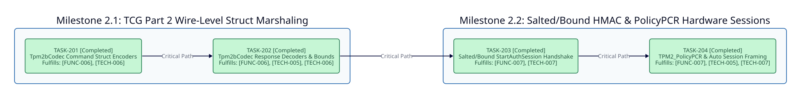

====================
Phase 2: Enhancement
====================

Timeline and Objectives
-----------------------

Deliver the ``v0.5.0`` hardware interoperability release by implementing full TCG TPM 2.0 Part 2 binary structure marshaling in ``Tpm2bCodec`` and stateful salted/bound HMAC and ``PolicyPCR`` hardware authorization sessions over physical ``/dev/tpmrm0`` devices.

Dependency Graph
----------------

Milestone 2.1: TCG Part 2 Wire-Level Struct Marshaling
------------------------------------------------------

* **TASK-201: Tpm2bCodec Command Structure Encoders**:

  * **Status**: Planned ``v0.5.0``
  * **Fulfills**: ``[FUNC-006]``, ``[TECH-006]``
  * **Blocked By**: Phase 1 ``TASK-105``
  * **Unblocks**: ``TASK-202``
  * **Deliverable**: Implement deterministic big-endian binary encoders in ``Tpm2bCodec`` for ``TPMS_AUTH_COMMAND``, ``TPM2B_SENSITIVE_CREATE``, ``TPM2B_PUBLIC``, and ``TPMS_ECC_PARMS`` for physical ``/dev/tpmrm0`` key creation and signing.

* **TASK-202: Tpm2bCodec Response Structure Decoders and Boundary Fuzzing**:

  * **Status**: Planned ``v0.5.0``
  * **Fulfills**: ``[FUNC-006]``, ``[TECH-005]``, ``[TECH-006]``
  * **Blocked By**: ``TASK-201``
  * **Unblocks**: ``TASK-203``
  * **Deliverable**: Implement overflow-safe binary decoders in ``Tpm2bCodec`` for ``TPMS_AUTH_RESPONSE``, ``TPM2B_PUBLIC``, and ``TPMT_SIGNATURE`` with strict length-prefix validation and malformed-input spec coverage.

Milestone 2.2: Salted/Bound HMAC and PolicyPCR Hardware Sessions
----------------------------------------------------------------

* **TASK-203: Hardware Salted and Bound StartAuthSession Handshake**:

  * **Status**: Planned ``v0.5.0``
  * **Fulfills**: ``[FUNC-007]``, ``[TECH-007]``
  * **Blocked By**: ``TASK-202``
  * **Unblocks**: ``TASK-204``
  * **Deliverable**: Implement ``TPM2_StartAuthSession`` and ``TPM2_FlushContext`` session lifecycle management in ``Session`` and ``TPMDevice``, including salted and bound ``sessionKey`` derivation via ``ParameterEncryption.kdfa``.

* **TASK-204: TPM2_PolicyPCR Execution and Automatic Session Framing**:

  * **Status**: Planned ``v0.5.0``
  * **Fulfills**: ``[FUNC-007]``, ``[TECH-005]``, ``[TECH-007]``
  * **Blocked By**: ``TASK-203``
  * **Unblocks**: ``v0.5.0`` Release
  * **Deliverable**: Implement ``TPM2_PolicyPCR`` digest extension and automatic ``TPMS_AUTH_COMMAND`` attachment and ``TPMS_AUTH_RESPONSE`` constant-time HMAC verification inside ``TPMDevice#execute``.

Critical Path
-------------

The Phase 2 execution critical path follows a strict sequential dependency chain:

``TASK-201 -> TASK-202 -> TASK-203 -> TASK-204``

**Feasibility Audit Stamp**: ``PASS: ZERO DEPENDENCY VIOLATIONS``
