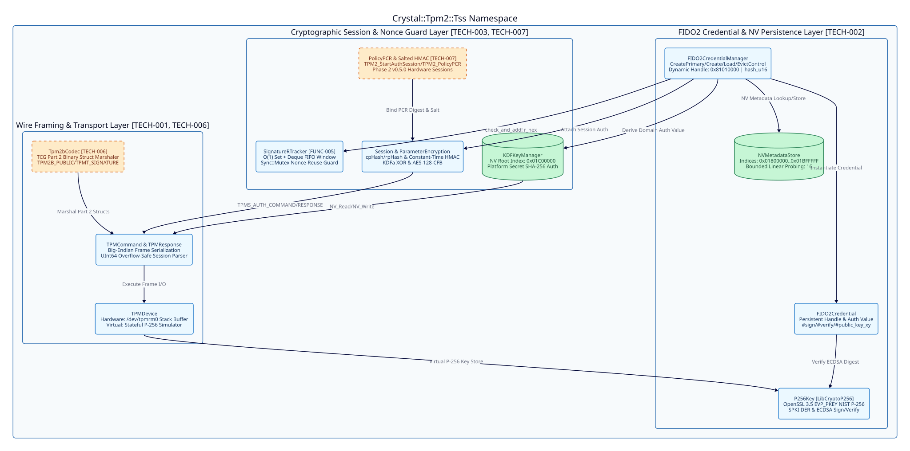

=====================
Architecture Overview
=====================

Requirement Mapping
-------------------

Fulfills ``[FUNC-001]``, ``[FUNC-002]``, ``[FUNC-003]``, ``[FUNC-004]``, ``[FUNC-005]``, ``[FUNC-006]``, ``[FUNC-007]`` in :doc:`../../functional/specs/core-requirements`.

System Topology Diagram
-----------------------

Phase 1 Technical Specifications
--------------------------------

* **[TECH-001] Wire Framing and Dual Transport Engine**:
  Fulfills ``[FUNC-001]``. Implemented across ``src/crystal-tpm2-tss/types.cr``, ``src/crystal-tpm2-tss/command.cr``, ``src/crystal-tpm2-tss/response.cr``, and ``src/crystal-tpm2-tss/device.cr``:

  * ``TPMCommand`` serializes big-endian command frames with ``TPM2::Tag::NO_SESSIONS`` or ``TPM2::Tag::SESSIONS``, 32-bit ``TPM_CC`` command codes, ordered 32-bit handle arrays, 4-byte length-prefixed ``TPMS_AUTH_COMMAND`` authorization areas via ``TPMCommand.build_password_auth`` and ``TPMCommand.build_session_auth``, and command parameter slices.
  * ``TPMResponse.parse`` validates 10-byte headers, widens session ``auth_size`` bounds arithmetic to ``UInt64`` prior to slicing response buffers, and extracts ``nonceTPM`` into active ``Session`` instances.
  * ``TPMDevice`` executes hardware I/O over ``/dev/tpmrm0`` using stack-allocated ``StaticArray(UInt8, 4096)`` buffers and provides a thread-safe virtual simulator guarded by ``Sync::Mutex``.

* **[TECH-002] OpenSSL 3.5 NIST P-256 and FIDO2 NV Persistence Layer**:
  Fulfills ``[FUNC-002]`` and ``[FUNC-003]``. Implemented across ``src/crystal-tpm2-tss/p256_key.cr``, ``src/crystal-tpm2-tss/fido2_credential.cr``, ``src/crystal-tpm2-tss/nv_metadata_store.cr``, and ``src/crystal-tpm2-tss/fido2_credential_manager.cr``:

  * ``P256Key`` binds directly to OpenSSL 3.5 ``libcrypto`` ``EVP_PKEY_Q_keygen``, ``EVP_PKEY_get_octet_string_param``, ``EVP_PKEY_sign``, ``EVP_PKEY_verify``, and ``d2i_PUBKEY`` to generate NIST P-256 keypairs, sign 32-byte digests into ``ECDSASignature`` value structs, and reconstruct verifiers from 32-byte ``x`` and ``y`` coordinates using a 26-byte ASN.1 ``SPKI_P256_PREFIX`` DER header.
  * ``NVMetadataStore`` partitions FIDO2 credential metadata into ``0x01800000..0x01BFFFFF`` using mask ``0x003FFFFF`` and resolves SHA-256 index collisions via bounded linear probing up to ``MAX_NV_PROBES = 16``.
  * ``FIDO2CredentialManager`` derives domain-separated ``FIDO2-AUTH-v1`` HMAC-SHA256 authorization values, maps each credential to a persistent handle ``0x81010000 | hash_u16``, orchestrates ``CreatePrimary``, ``Create``, ``Load``, ``EvictControl``, ``FlushContext``, and ``ReadPublic``, and returns ``FIDO2Credential`` instances supporting ``#sign``, ``#verify``, and ``#public_key_xy``.

* **[TECH-003] KDF Root Persistence, Session Encryption, and O(1) Nonce Guard**:
  Fulfills ``[FUNC-004]`` and ``[FUNC-005]``. Implemented across ``src/crystal-tpm2-tss/kdf_key_manager.cr``, ``src/crystal-tpm2-tss/session.cr``, ``src/crystal-tpm2-tss/parameter_encryption.cr``, and ``src/crystal-tpm2-tss/signature_r_tracker.cr``:

  * ``KDFKeyManager`` provisions and caches a 32-byte master key at NV index ``0x01C00000`` protected by ``SHA256(platform_secret)``.
  * ``Session`` synchronizes ``@nonce_caller``, ``@nonce_tpm``, and ``@session_key`` via ``Sync::Mutex``, computes TCG TPM 2.0 Part 1 Section 19.6.5 ``cpHash`` and ``rpHash`` digests, and verifies response HMACs in constant time via ``Crypto::Subtle.constant_time_compare``.
  * ``ParameterEncryption`` implements TCG TPM 2.0 Part 1 Section 11.4.9.2 ``KDFa`` counter-mode key derivation for ``XOR`` parameter obfuscation and ``AES-128-CFB`` encryption/decryption.
  * ``SignatureRTracker`` enforces atomic ``O(1)`` ECDSA ``r``-component duplicate detection via ``Set(String)`` and ``Deque(String)`` with 50% FIFO batch eviction when capacity exceeds ``@max_size``.

Phase 2 Technical Specifications
--------------------------------

* **[TECH-006] Tpm2bCodec TCG Part 2 Binary Marshaler**:
  Fulfills ``[FUNC-006]`` for Phase 2 ``v0.5.0``. Defined in :doc:`../../adrs/2026-10-18-phase-2-tcg-part2-marshaling-and-policypcr`:

  * ``Tpm2bCodec`` will reside in ``src/crystal-tpm2-tss/tpm2b_codec.cr`` and provide zero-copy big-endian binary encoders and decoders for ``TPMS_AUTH_COMMAND``, ``TPMS_AUTH_RESPONSE``, ``TPM2B_SENSITIVE_CREATE``, ``TPM2B_PUBLIC``, ``TPMS_ECC_PARMS``, and ``TPMT_SIGNATURE``.
  * Every decoder must validate nested ``UInt16``/``UInt32`` size prefixes against remaining slice bounds before allocation and raise ``TPMError`` on trailing or truncated bytes.

* **[TECH-007] Salted/Bound HMAC and PolicyPCR Session State Machine**:
  Fulfills ``[FUNC-007]`` for Phase 2 ``v0.5.0``. Defined in :doc:`../../adrs/2026-10-18-phase-2-tcg-part2-marshaling-and-policypcr`:

  * ``Session`` and ``TPMDevice`` will implement ``TPM2_StartAuthSession`` with salted and bound ``sessionKey`` derivation via ``ParameterEncryption.kdfa``, ``TPM2_PolicyPCR`` digest extension, and ``TPM2_FlushContext`` session teardown.
  * ``TPMDevice#execute`` will automatically attach ``TPMS_AUTH_COMMAND`` frames, decrypt encrypted response parameters, and verify ``TPMS_AUTH_RESPONSE`` HMACs before returning ``TPMResponse`` to callers.

Memory and Concurrency Profile
------------------------------

All mutable session nonces, NV caches, virtual device stores, and ``SignatureRTracker`` windows are synchronized via ``Sync::Mutex`` for safe concurrent execution across Crystal 1.21 multithreaded Execution Contexts. Hardware command responses read into stack-allocated ``StaticArray(UInt8, 4096)`` buffers, while ``ECDSASignature`` uses immutable value ``struct`` semantics.
